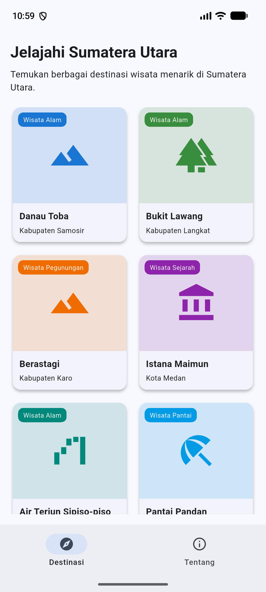
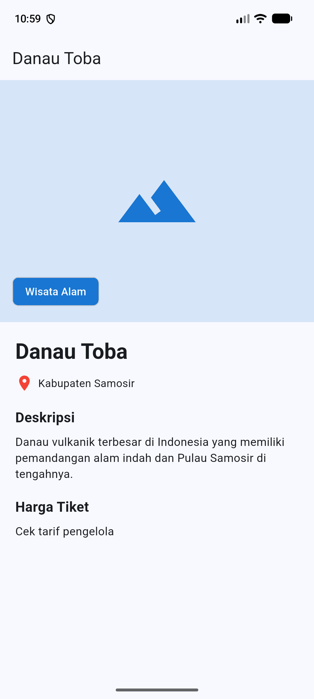
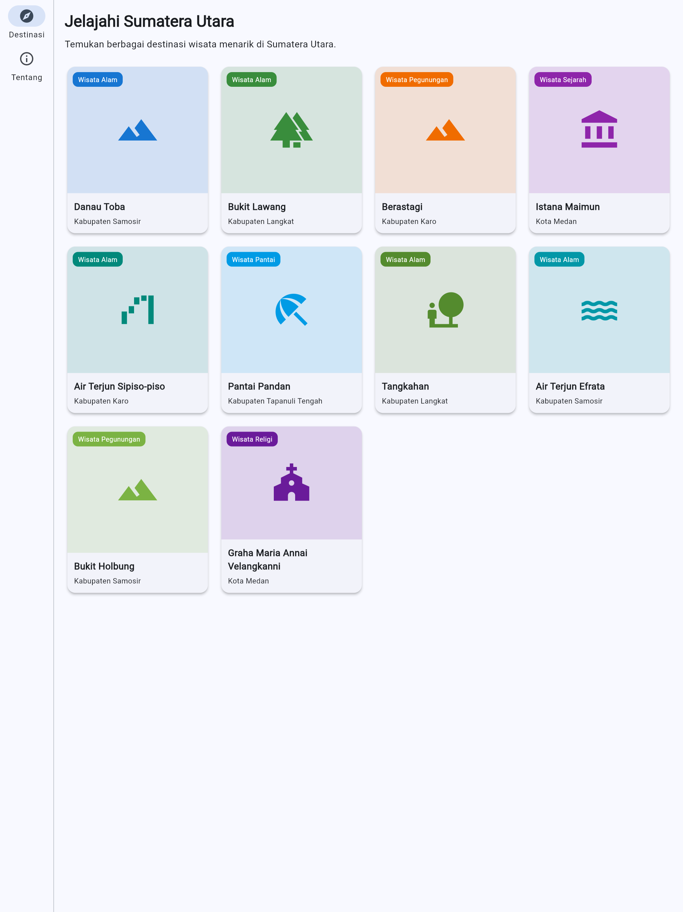
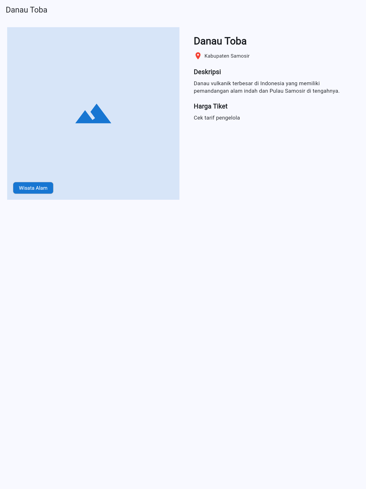

# Aplikasi Wisata Sumatera Utara

## A. Identitas Mahasiswa

- **Nama:** Chelsea Febiola br Sebayang
- **NIM:** 4243250015
- **Mata Kuliah:** Pemrograman Mobile
- **Program Studi:** Ilmu Komputer
- **Universitas:** Universitas Negeri Medan
- **Tugas:** Tugas Rutin 6 – Pertemuan 6

## B. Deskripsi Aplikasi

Wisata Sumatera Utara merupakan aplikasi mobile yang menyediakan informasi berbagai destinasi wisata di Sumatera Utara. Aplikasi ini menampilkan daftar destinasi dalam bentuk grid dan menyediakan halaman detail yang berisi nama, lokasi, kategori, deskripsi, serta informasi tiket.

Aplikasi memiliki 10 destinasi wisata, yaitu Danau Toba, Bukit Lawang, Berastagi, Istana Maimun, Air Terjun Sipiso-piso, Pantai Pandan, Tangkahan, Air Terjun Efrata, Bukit Holbung, dan Graha Maria Annai Velangkanni.

## C. Fitur Aplikasi

- Menampilkan 10 destinasi wisata.
- Grid katalog responsif.
- Halaman detail setiap destinasi.
- Navigasi menggunakan go_router.
- NavigationBar untuk layar kecil.
- NavigationRail untuk layar lebar.
- Penanganan ID destinasi yang tidak ditemukan.

## D. Screenshot Aplikasi

### 1. Tampilan Ponsel (Mobile)

**a. Halaman Katalog Destinasi Wisata**

Menampilkan daftar 10 destinasi wisata Sumatera Utara dalam bentuk grid dengan dua kolom. Pengguna dapat memilih destinasi untuk melihat informasi lebih lanjut.

**b. Halaman Detail Destinasi Wisata**

Menampilkan informasi lengkap destinasi yang dipilih, meliputi nama tempat wisata, kategori, lokasi, deskripsi, dan informasi harga tiket.

### 2. Tampilan Tablet

**a. Halaman Katalog Destinasi Wisata**

Menampilkan daftar destinasi wisata dengan tata letak grid yang menyesuaikan ukuran layar tablet serta menggunakan NavigationRail sebagai navigasi utama.

**b. Halaman Detail Destinasi Wisata**

Menampilkan informasi destinasi dengan tata letak horizontal, yaitu ikon atau ilustrasi destinasi di satu sisi dan informasi detail di sisi lainnya.

## E. Penjelasan Desain Responsif

Aplikasi Wisata Sumatera Utara dirancang agar dapat digunakan pada berbagai ukuran layar, mulai dari ponsel hingga tablet dan layar lebar. Pada halaman katalog, saya menggunakan LayoutBuilder untuk membaca lebar ruang yang tersedia dan menentukan jumlah kolom grid. Jika lebar layar kurang dari 600 dp, katalog menampilkan dua kolom. Pada lebar 600 hingga kurang dari 900 dp, katalog menampilkan tiga kolom. Sementara itu, layar dengan lebar minimal 900 dp menampilkan empat kolom.

Pada halaman detail, LayoutBuilder digunakan untuk menyesuaikan susunan informasi. Layar dengan lebar kurang dari 600 dp menggunakan susunan vertikal, sedangkan layar yang lebih lebar menggunakan susunan horizontal agar ikon dan informasi destinasi dapat ditampilkan berdampingan. Saya juga menggunakan SingleChildScrollView agar konten dapat digulir dan tidak terpotong. Untuk navigasi, NavigationBar digunakan ketika lebar layar kurang dari 840 dp, sedangkan NavigationRail digunakan pada layar minimal 840 dp. Widget Expanded dan ellipsis membantu mengatur ruang serta menangani teks yang panjang. Dengan pendekatan tersebut, tampilan aplikasi dapat menyesuaikan ukuran perangkat dan mengurangi risiko overflow.

## F. Teknologi

- Flutter
- Dart
- Material 3
- go_router

## G. Pernyataan Penggunaan AI

Dalam pengerjaan tugas ini, saya menggunakan ChatGPT sebagai alat bantu untuk memahami konsep Flutter, menyusun dan memperbaiki kode, serta mengatasi kendala selama proses pengembangan. Saya melakukan pengujian aplikasi dan memeriksa hasil kode menggunakan flutter analyze.

